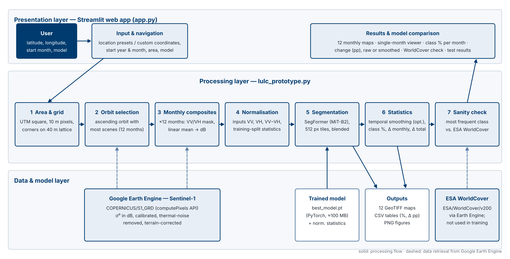
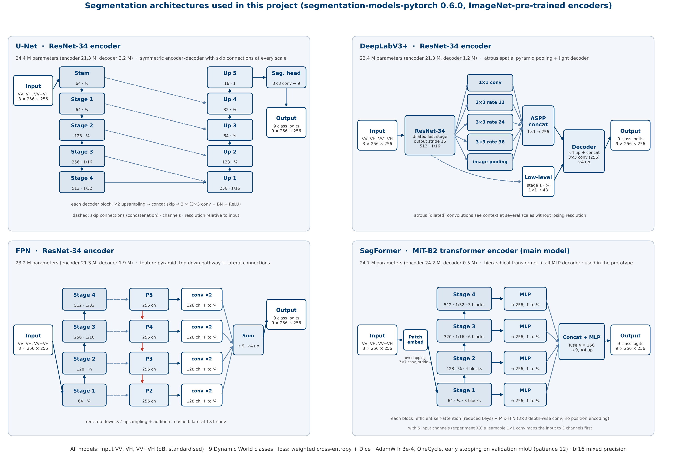

# Monthly LULC Monitoring from Sentinel-1 SAR with Deep Learning

**Pooja Chandrappa · Deep Learning · SRH Hochschule Heidelberg · 2026**

Semantic segmentation of land use / land cover (9 Dynamic World classes) with **Sentinel-1 radar (VV, VH) as the only input**,
and a Streamlit prototype that produces **12 monthly LULC maps**, class percentages and month-to-month / total change
for any location and start month.

## Public links

| What | Link |
|---|---|
| Dataset – Sentinel-1 monthly composites (GeoTIFF, 10 m + 40 m) | https://drive.google.com/drive/folders/1Hk1nD1vfaNckx05vt3LJUOlaBgik4x70?usp=sharing |
| Dataset – Dynamic World monthly labels (GeoTIFF, 10 m + 40 m) | https://drive.google.com/drive/folders/1rU4ORHNPlosup3YXDADjl2RrlCuzrhiD?usp=sharing |
| Training code | this repository: [`scripts/`](scripts), [`notebooks/`](notebooks), [`gee/`](gee) |
| Model weights (all 20 trained models + best model) | https://drive.google.com/drive/folders/1OFYCDR44ozFbC2PLM6roL58yp24_wAnn?usp=sharing |
| Prototype code | this repository (top level): [`app.py`](app.py), [`lulc_prototype.py`](lulc_prototype.py), [`temporal_smoothing.py`](temporal_smoothing.py), [`07_prototype.ipynb`](07_prototype.ipynb) — setup in [`PROTOTYPE_README.md`](PROTOTYPE_README.md) |
| Demo video | https://drive.google.com/file/d/1T2VQMbsiy4PeoAHiO94rzmO115nKYYiy/view?usp=sharing |

## Results (test set, spatially separate areas, reference: Dynamic World)

| Model (trained and tested at 10 m) | OA | mIoU | mean F1 |
|---|---|---|---|
| **SegFormer (MiT-B2)** | **0.832** | **0.432** | **0.537** |
| U-Net (ResNet-34) | 0.818 | 0.423 | 0.531 |
| FPN (ResNet-34) | 0.816 | 0.400 | 0.496 |
| DeepLabV3+ (ResNet-34) | 0.810 | 0.407 | 0.509 |

Per-class test IoU (SegFormer 10 m): Built-up 0.844 · Trees 0.788 · Crops 0.730 · Water 0.669 · Grass 0.338 ·
Snow 0.233 · Shrub 0.166 · Bare 0.080 · Flooded vegetation 0.041 (Cohen's κ 0.769).

**Experiments (20 trained models):** 4 architectures trained at 10 m and at 40 m, SegFormer and U-Net also with mixed 10 m + 40 m training, each tested in 3 modes;
input experiments (month encoding, confidence-weighted loss, Lee speckle filter, seed); fine-tuning (no pre-training,
MiT-B0/B4, cosine schedule, learning rate, class weights). Only ImageNet pre-training (−0.032 mIoU without it) and
matching the training resolution clearly change accuracy; all other changes stay within the run-to-run variation
(±0.011 mIoU). Temporal smoothing removes 53–73 % of the apparent monthly change in the prototype output.





## Repository structure

```
gee/                      Google Earth Engine scripts: Sentinel-1 monthly composites, Dynamic World monthly labels
notebooks/                01–11: data transfer, inspection, patch preparation, training curves, monthly statistics,
                          test results, training diagnostics, experiments and temporal smoothing (with outputs)
scripts/                  train.py, evaluate.py, predict_maps.py, speckle_filter.py, weak_class_diagnostics.py,
                          run_finetune.sh, clean_notebooks.py
docs/                     system and model architecture figures
app.py                    prototype: Streamlit web app
lulc_prototype.py         prototype: retrieval, compositing, segmentation, statistics (also a command-line tool)
temporal_smoothing.py     prototype: temporal smoothing of the 12 monthly maps + smoothing analysis
07_prototype*.ipynb       prototype notebooks: Frankfurt (case study), Mannheim, Cairo
evaluation/               all evaluation results: test / train / validation / experiment tables, confusion matrix,
                          weak-class diagnostics and report figures (also used by the app)
example_results/          tables and figures of the prototype runs (Frankfurt, Mannheim, Cairo, 40 m runs, smoothing)
model/                    put best_model.pt here (download link above)
prototype/.streamlit/     app colour settings (copy to .streamlit/ next to app.py to use them)
PROTOTYPE_README.md       how to install and run the prototype
```

## Data and preprocessing (summary)

- **Input:** `COPERNICUS/S1_GRD`, IW, VV + VH, ascending, relative orbit 15 (GEE: thermal-noise removal, radiometric
  calibration, terrain correction). Monthly composite: common VV/VH mask, mean in linear power → dB (2–8 scenes).
- **Labels:** `GOOGLE/DYNAMICWORLD/V1`, monthly mean class probabilities → argmax (9 classes); 40 m labels by majority of
  4 × 4 one-hot fractions (no bilinear resampling).
- **Area / period:** Heidelberg – Rhine-Neckar, ≈ 40 × 40 km (EPSG:32632), January–December 2025.
- **Split:** 25 spatial super-blocks of 7.68 km → 17 train / 4 val / 4 test, same for all months and resolutions
  (0 shared blocks). Patches 256 × 256 px (10 m) / 64 × 64 px (40 m). Normalisation from the training split only.

## Reproduce

1. Run the two scripts in `gee/` in the Earth Engine Code Editor (exports to Google Drive), or download the dataset above.
2. `pip install -r requirements.txt`, then notebooks 02–04 (download, alignment, patches).
3. Train, e.g. `python3 scripts/train.py --arch segformer --train-res 10`; evaluate with `python3 scripts/evaluate.py`.
4. Prototype: see [`PROTOTYPE_README.md`](PROTOTYPE_README.md) (Python 3.11, Earth Engine account, `streamlit run app.py`).
   Put the downloaded `best_model_segformer_10m.pt` into `model/` and rename it to `best_model.pt`.

Paths in the scripts point to the SRH Data Lab project folder (`PROJ` at the top of `scripts/train.py`); change it for
another machine.

## Required accounts

- Google Earth Engine (free noncommercial use) with a Google Cloud project ID – for the GEE scripts and the prototype.
- No paid services and no API keys are needed.
